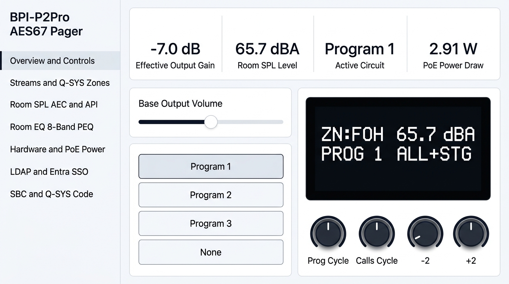
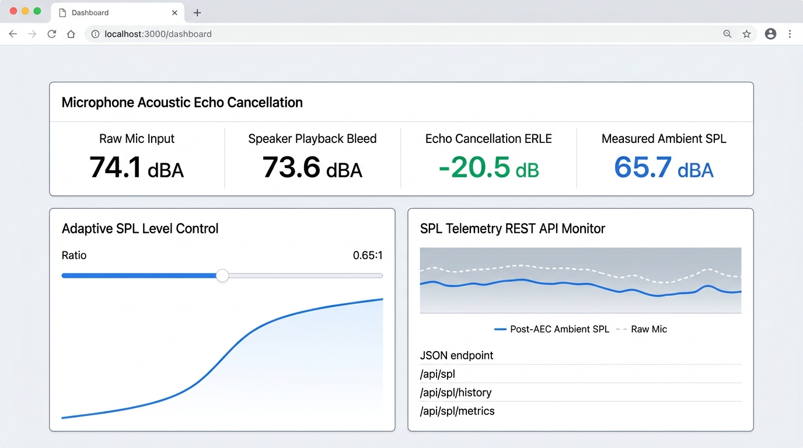
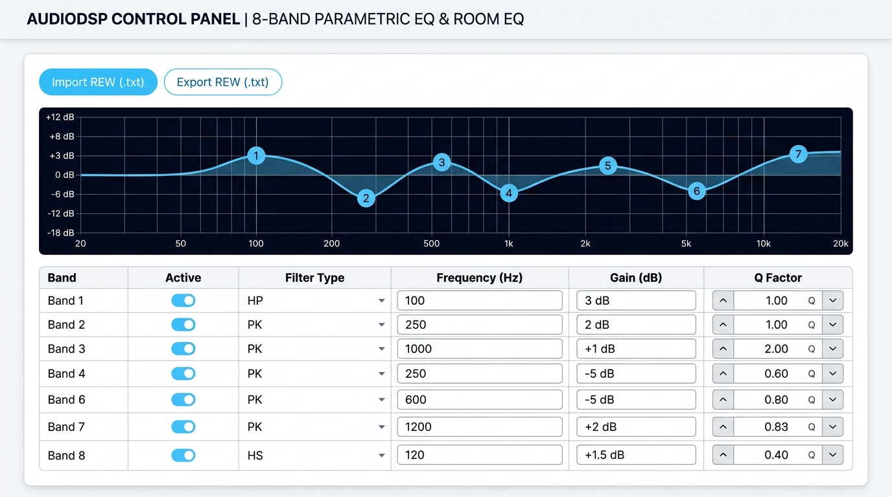
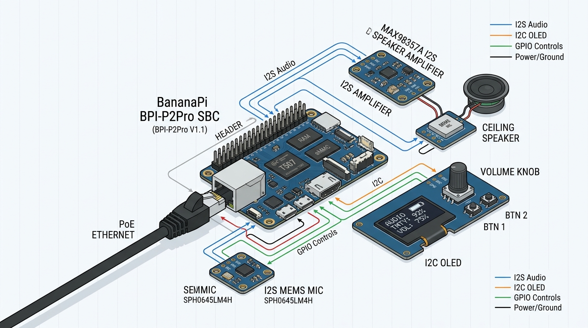

# BPI-P2Pro AES67 PoE Paging Speaker System

A complete **Armbian SBC AES67 paging speaker platform** (tailored for the PoE-powered **BananaPi BPI-P2Pro**), paired with a **Q-SYS Designer Zone & Call Controller plugin (`.qplug`)** and a **web configuration & telemetry console**.

---

## Key Capabilities

- **AES67 Multi-Protocol Audio Ingestion**: Receives 5 independent audio channels—`Stage Calls`, `All Calls`, `Program 1` (Mono/Stereo), `Program 2` (Mono/Stereo), and `Program 3` (Mono/Stereo)—via **SAP** (`224.2.127.254:9875`), **RTSP** (`DESCRIBE`/`SETUP`/`PLAY`), or **Q-SYS Announcement**.
- **Flexible SBC Audio Output & Mic Input**: Drives either an **I2S Class-D Amplifier** (e.g., MAX98357A / TAS5805M) or the **onboard audio output**, and reads room SPL from an **I2S MEMS microphone** (e.g., ICS-43434) or **onboard ADC**.
- **Acoustic Echo Cancellation (AEC) for Accurate Room SPL**: Uses GStreamer `webrtcechoprobe` → `webrtcdsp` to cancel speaker playback from the microphone before calculating ambient room dBA, ensuring speaker output never inflates adaptive gain.
- **Configurable Adaptive SPL Gain**: Automatically increases speaker output proportionally (`0.0:1` to `1.5:1` ratio) above a configurable noise-floor threshold (`dBA`) with max-boost clamping and voice-paging hold.
- **8-Band Parametric EQ & Room EQ Wizard (REW)**: Inline 8-band biquad room-correction EQ (`PK`, `LS`, `HS`, `HP`, `LP` + preamp headroom trim) with direct import/export of **Room EQ Wizard (REW)** `.txt` filter files.
- **SPL Monitoring REST API**: Exposes `GET /api/spl`, `GET /api/spl/history`, and Prometheus `GET /api/spl/metrics` for external acoustic monitoring and dashboards.
- **Room Clustering ("Room" Sync)**: Groups multiple speakers into a Room over multicast (`239.255.77.68:7768`) to share combined SPL measurements (`mean`, `max`, or `primary`) and mirror settings across headless units without local buttons, knobs, or screens.
- **Optional Physical Controls & OLED**: Supports GPIO pushbuttons (**Program Cycle**: `1 → 2 → 3 → None → 1`; **Calls Cycle**: `Stage → All → None`, with web policy to lock out `None`), a quadrature rotary volume knob, and an I2C `128×64` OLED screen with sleep timeout.
- **PoE Power Minimization & Schedules**: Cuts quiescent power via CPU `powersave` governor, disabling HDMI/Wi-Fi/BT/LEDs, `SD_MODE` amplifier shutdown GPIO, and scheduled Silent / Deep Low-Power off-hours windows with Emergency All-Call wake override.
- **Q-SYS Plugin & Auto-Detected Zones**: Auto-discovers venue zones (`FOH`, `Backstage`, `Restaurant`, `Studio Theatre FOH`, `Studio Theatre Backstage`) broadcast by `AES67_Paging_Controller.qplug` and configures all 5 streams and defaults automatically.
- **Enterprise SSO (LDAP & Microsoft Entra ID)**: Supports LDAPS and Entra OIDC authentication with configurable Admin Group DN / Object ID enforcement.

---

## Screenshots

### Overview & Live Hardware / OLED Emulator


### Room SPL, Acoustic Echo Cancellation & REST API Monitor


### 8-Band Parametric EQ & Room EQ Wizard (REW) Correction


### BananaPi BPI-P2Pro PoE Hardware Architecture


---

## Repository Structure

```text
├── server.ts                          # Express backend, REST API, state store, Vite dev host
├── src/                               # React + TypeScript web configuration console
│   ├── App.tsx
│   ├── types.ts
│   └── components/
│       ├── OverviewTab.tsx            # Base volume, Program/Calls modes, KPI strip
│       ├── OledHardwarePanel.tsx      # 128x64 SSD1306 OLED & button/knob emulator
│       ├── StreamsZonesTab.tsx        # Q-SYS zone auto-detection, priority & 5 channels
│       ├── SplRoomTab.tsx             # I2S/onboard I/O, AEC, adaptive SPL, REST monitor & Room mesh
│       ├── RoomEqTab.tsx              # 8-band biquad PEQ curve & REW .txt import/export
│       ├── HardwarePowerTab.tsx       # GPIO pins, Calls None lock, PoE & schedule windows
│       ├── AccessSsoTab.tsx           # LDAP & Microsoft Entra ID group RBAC
│       └── DeploymentTab.tsx          # In-browser code viewer & bundle downloader
├── sbc/
│   ├── aes67_daemon.py                # Armbian Python/GStreamer/libgpiod/OLED/REST daemon
│   ├── install-bpi-p2pro.sh           # Armbian setup (I2S/I2C overlays, linuxptp, power tuning)
│   └── aes67-pager.service            # Real-time FIFO systemd unit
├── qsys/
│   └── AES67_Paging_Controller.qplug  # Q-SYS Designer Lua plugin for Zones & Call Circuits
└── docs/
    ├── HARDWARE_AND_ARMBIAN.md        # BPI-P2Pro pinout, I2S/I2C overlays, PTPv2 & PoE power
    ├── QSYS_AND_ROOM_CLUSTERING.md    # Q-SYS plugin deployment, Zone JSON & Room cluster sync
    └── API_AND_REW_GUIDE.md           # SPL REST API, Prometheus metrics & REW filter workflow
```

---

## Quick Start

### 1. Run the Web Management Console

```bash
npm install
npm run dev
```

The console and REST API start on **`http://localhost:3000`**. For production builds:

```bash
npm run build
npm start
```

### 2. Deploy to BananaPi BPI-P2Pro (Armbian)

Copy the `/sbc` directory onto your Armbian target and run the installer as root:

```bash
sudo bash sbc/install-bpi-p2pro.sh
sudo reboot
```

After reboot, verify IEEE-1588v2 PTP synchronization and daemon health:

```bash
systemctl status ptp4l aes67-pager
curl -s http://localhost:8080/api/spl | jq
```

### 3. Load the Q-SYS Designer Plugin

1. Copy `qsys/AES67_Paging_Controller.qplug` into your Q-SYS Designer `Plugins` folder (e.g., `Documents/QSC/Q-Sys Designer/Plugins`).
2. Drag **AES67 Paging > SBC Zone Controller** into your schematic and set the `Zone Count` and `Multicast Address` (`239.255.77.67`).
3. Wire your Q-SYS paging router/microphone status pins to each zone's `StageCallActive` and `AllCallActive` inputs.

---

## Further Documentation

- [Hardware Wiring, Armbian Overlays & PoE Power Guide](docs/HARDWARE_AND_ARMBIAN.md)
- [Q-SYS Plugin Integration & Room Clustering](docs/QSYS_AND_ROOM_CLUSTERING.md)
- [SPL REST API, Prometheus & Room EQ Wizard (REW) Guide](docs/API_AND_REW_GUIDE.md)
